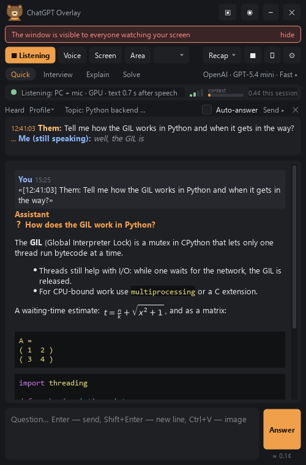
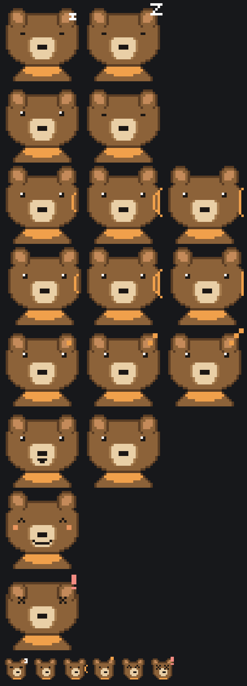
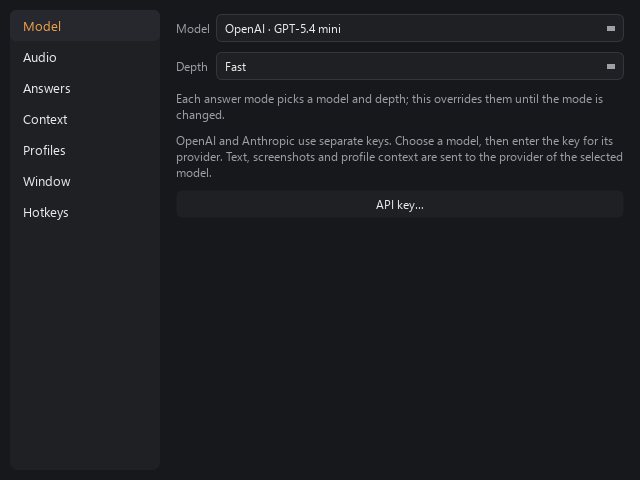

# ChatGPT Overlay

**New in 3.2:** compact window (`Ctrl+Alt+C`), a remembered capture region (`Ctrl+Alt+R`; choose a new one with `Ctrl+Alt+Shift+R`), and push-to-talk (`Ctrl+Alt+V`). Hold Voice or its shortcut and release to submit your spoken question. Esc in the app or Stop discards it. The first voice use loads/downloads the local speech model; later questions reuse it.

The compact view shows only the latest answer and a small input, while the full view keeps the conversation. Window sizes and positions are remembered separately. Area selects once and reuses that exact physical region; Area ▾ offers replacement and reset. If the region is no longer on a connected monitor, the app asks you to select another instead of capturing more of the screen.

A small window that stays on top of everything else and helps you during a call, an interview, a lecture, or while you work on a task that is on your screen. It listens to the sound on your computer, writes down what is said, finds the question and asks the selected OpenAI or Anthropic model. You can also show it a screenshot or type a question yourself. People watching your shared screen do not see the window.

Speech is turned into text on your own computer. Nothing leaves it until you ask a question, and then only the text and the screenshot go to the selected provider.

**OpenAI support (3.1):** existing hotkeys, local speech recognition, screenshots, streaming, profiles and summaries are preserved. See [the Russian quick start](docs/QUICKSTART_RU.md). Remaining future ideas are in [IDEAS.md](docs/IDEAS.md).

**Contents:** [Install](#install) · [First start](#first-start) · [A tour of the window](#a-tour-of-the-window) · [Everyday use](#everyday-use) · [Bobo](#bobo) · [Recap and call summary](#recap-and-call-summary) · [Profiles](#profiles) · [Cost and budget](#cost-and-budget) · [Hotkeys](#hotkeys) · [Settings](#settings) · [Privacy](#privacy) · [If something goes wrong](#if-something-goes-wrong) · [Updating](#updating) · [License](#license)

## Install

You need Windows 10 (version 2004 or newer) or Windows 11, Python 3.12 or newer, and an OpenAI API key (or an Anthropic key for Claude models). An NVIDIA graphics card makes speech recognition much faster but is not required.

1. **Get an API key.** Create one at [OpenAI API Keys](https://platform.openai.com/api-keys), and configure API billing. For Claude models, use [Anthropic Console](https://platform.claude.com) instead. Select the corresponding provider in the connection dialog.
2. **Download the project** and unpack it into any folder.
3. **Run `setup.bat`.** It creates a private Python environment inside the folder and installs everything the app needs. With an NVIDIA card it also installs the CUDA libraries for fast speech recognition (about 1.2 GB). This takes a few minutes.

Nothing is installed outside the folder. The only other thing on your disk is the speech model, downloaded once into `%USERPROFILE%\.cache\huggingface`: about 1.6 GB with a graphics card, about 0.5 GB without one.

## First start

Double-click `start.bat`.

The first time, a welcome window asks you to choose **OpenAI / ChatGPT** or **Anthropic / Claude** and enter its API key. Paste it, press **Check** to verify the key and model access (this does not check your billing balance), choose what the app should listen to, and press **Save and continue**. The key is stored encrypted; only your Windows account on this computer can read it. **Later** skips the dialog; the app then works without answers until a key is given.

The window appears at the top right of the screen. Press **Listen** once: the app downloads its speech model (the status line shows the progress) and starts listening. From then on, listening starts within a second.

If you prefer, you can skip the dialog and put the key into the `.env` file next to `start.bat` as `OPENAI_API_KEY=…` (`ANTHROPIC_API_KEY=…` for Anthropic); it is encrypted and removed from the file on the next start.

## A tour of the window

From top to bottom:

- **Title bar.** Bobo the bear, the name, and three buttons: ◉ keeps the window above all others (click it to let other windows cover it), ─ minimizes, ✕ hides the window to the tray. Drag the title to move the window, drag any edge or corner to resize it, snap it to the side of the screen like any other window.
- **Toolbar.** **Listen** starts and stops listening. **Screen** takes a screenshot of the monitor under the mouse and asks the selected OpenAI or Anthropic model about it. **Area** lets you select part of the screen with the mouse first. **Recap** summarizes what was said recently (see below). ■ stops an answer that is being written, ＋ starts a new conversation, ⚙ opens the settings.
- **Modes.** Quick, Interview, Explain, Solve: how the model should answer. On the right you see the model and depth the mode picked; click it to change them.
- **Status line.** A colored dot and a sentence say what the app is doing: grey when idle, green while listening, orange while the model thinks or writes, red on an error. While listening, four small bars show the sound level. Two thin meters show how full the conversation is and how much of your monthly budget is spent, and on the right, what this session has cost so far.
- **Heard.** What was heard since the last question, with the time of each phrase in orange. In a call, lines from the other side are marked *Them* and yours *Me*. You can edit this text before sending it: if a name or a term was misheard, fix it here. ✕ forgets it. **Send ▸** asks the selected OpenAI or Anthropic model about what was heard, without anything typed. **Auto-answer** sends by itself once a question is heard and the speaker pauses. **Profile** picks a saved scenario (see Profiles); the topic, if one is set, is shown next to it.
- **Chat.** Your questions and the model's answers. Code is highlighted, formulas and tables are rendered. Under each answer: how long it took and what it cost, then **copy**, **Shorter**, **More detail** and **Deeper**.
- **Question box.** Type a question and press Enter. Shift+Enter starts a new line, Esc stops a running answer. Paste a picture with Ctrl+V or drop an image file here: it goes with your next question. The small figure under **Answer** estimates what the next question will cost.

The bars above and below the chat can be dragged to give Heard or the question box more room. Until you drag them, both grow and shrink with their text. Ctrl + mouse wheel changes the text size.

## Everyday use

### On a call or in an interview

Open ⚙ → *Audio* and set *Listen to* to **PC + mic**. Press **Listen**. The other side's words appear as *Them*, yours as *Me*. When a question comes up, press **Answer** (or `Ctrl+Alt+A`): The model reads everything heard since the last question, picks the question addressed to you, and answers it. The first line of the answer, "❓ …", shows which question it picked, so you can tell at a glance whether it understood.

Tick **Auto-answer** and the app sends by itself about a second after a question is asked, as long as the speaker pauses.

The **Interview** mode gives a natural answer you can say out loud: a few sentences, key terms in bold, no lists unless the question asks for a list.

Wear headphones if you can. Without them the microphone also hears the speakers; the app filters most of that echo, but not all of it.

### At a lecture or with a video

Set *Listen to* to **PC audio** for a video or an online lecture, or **Microphone** if you are in the room. Put the subject into the topic and tricky words into the terms (⚙ → *Context*), for example names or `PostgreSQL`: they are recognized more reliably. The **Explain** mode gives explanations with an example and the usual mistakes, written to learn from.

### A task on the screen

Press **Screen** (`Ctrl+Alt+S`) for the whole monitor or **Area** (`Ctrl+Alt+R`) to select part of it. Whatever was said recently goes along with the picture, so "solve number three" together with a screenshot of the test works. The **Solve** mode shows every step, checks the result and ends with the answer; formulas are drawn properly.

### Typing a question

Just type and press Enter. A typed question has priority: the heard text and the screenshot become context for it. Use the **Quick** mode for short factual answers.

### After an answer

**Shorter** asks for two or three sentences you can say out loud. **More detail** adds details, an example and pitfalls. **Deeper** sends the same question to GPT-5.5 (OpenAI) or Opus (Anthropic) with more thinking time. It keeps the selected provider. **copy** puts the answer on the clipboard as text.

## Bobo

Bobo shows what the app is doing. The big Bobo in an empty chat waves when you click him and starts or stops listening; a right-click opens a quick menu with Listen, Recap, Settings and Quit. The tray icon shows the same face, so you can see whether the app is listening even when the window is hidden.

| Bobo | Means |
|---|---|
| Asleep, with a Z | Not listening |
| Ears up, sound waves | Listening; the waves move while someone speaks |
| Looking up, dots above the head | The model is thinking |
| Mouth moving | The model is writing the answer |
| Smiling, blushing | The answer is done |
| Crossed eyes, ears down, red mark | Something failed; the status line says what |
| Wide eyes, sweat drop, blinking red lamp | The window is visible to people watching your screen |
| Waving | Saying hello |

## Recap and call summary

Got distracted? Press **Recap** (`Ctrl+Alt+M`) for a short retelling of the last five minutes: the key points, questions addressed to you, decisions. The menu next to the button offers the last 2, 5 or 15 minutes, or everything heard.

At the end of a call, **Recap → Call summary** writes a summary with the topics, decisions and agreements, the questions you were asked and how they went, action items and open questions. Under it there is **save .md**: the only way a transcript ever reaches your disk, and only when you ask for it.

Both use everything heard since the conversation was started (＋ starts over).

## Profiles

A profile is a saved scenario: "Interview at Acme", "Algorithms course", "Daily stand-up". It keeps the answer mode, the model and depth, what to listen to, the languages, the topic and terms, notes about you, and documents.

The notes are instructions in your own words: "I am a junior Python developer with two years of Django, answer as me." The documents are text, Markdown or PDF files, for example your CV, the job description or lecture notes. The model reads them with every answer, so answers in an interview sound like you and match the role. Up to 30 000 characters go with each conversation; cache discounts depend on the provider and whether the API reports a cache hit.

Open **Profile** above Heard to switch profiles or to manage them. Switching a profile during a conversation restarts the chat and keeps the last answers as context, because the instructions the model sees have changed.

Profiles are plain files in the `profiles` folder next to the app, one subfolder per profile. They are yours to back up or delete.

## Cost and budget

- Under each answer you see what it cost, calculated from the token counts the API reports.
- The small figure under **Answer** estimates the next question before you send it; hover it to see the estimate for each model. It is an estimate: the exact amount appears under the answer.
- The **context** meter in the status line shows how much of the conversation limit is used. At 100 % the chat restarts by itself with a recap of the last answers, so nothing stops; it just forgets older turns.
- Set a monthly limit in ⚙ → *Answers* and a **budget** meter appears next to it. The spent amount is kept between starts and resets on the first of the month. When the limit is reached the status line tells you; the app keeps working.
- Models: **GPT-5.4 mini** is the OpenAI default; **GPT-5.5** handles Solve and Deeper. Original Sonnet, Opus, Opus ⚡ and Haiku profiles remain selectable. Mode presets stay within the selected provider. See [OpenAI model pricing](https://developers.openai.com/api/docs/pricing) for API rates. The pre-send OpenAI estimate assumes uncached input; the amount under the answer uses reported token counts, including cache discounts and reasoning output tokens.

## Hotkeys

They work from any window, so you never have to switch to the app during a call.

| Action | Default |
|---|---|
| Answer what was heard (and typed) | `Ctrl+Alt+A` |
| Screenshot of the monitor under the mouse → answer | `Ctrl+Alt+S` |
| Select an area of the screen → answer | `Ctrl+Alt+R` |
| Start or stop listening | `Ctrl+Alt+L` |
| Recap of the last minutes | `Ctrl+Alt+M` |
| Show or hide the window | `Ctrl+Alt+H` |

Change them in ⚙ → *Hotkeys*: click a combination and press the new keys. If another program already holds a combination, the status line says so at start.

Inside the window: Enter sends, Shift+Enter breaks a line, Esc stops an answer, Ctrl+V pastes an image, Ctrl + wheel or `Ctrl+=` / `Ctrl+-` change the text size and `Ctrl+0` resets it, `Ctrl+Q` quits.

## Settings

- **Model.** Choose a model and use **API key…** to add or replace the key without restarting. The model and the thinking depth (Fast, Balanced, Deep). Each mode picks its own; a change here holds until you switch modes.
- **Audio.** What to listen to (PC audio, microphone, or both), which output device and microphone to use, the speech language (Auto handles Russian, Ukrainian and English), how sensitive the speech detector is, and how long a pause ends a phrase.
- **Answers.** The reply language, auto-answer, after how many idle minutes the chat is cleared from memory (0 never), and the monthly budget.
- **Context.** The topic and the terms: they help speech recognition and tell the model what the conversation is about. A profile sets them too.
- **Profiles.** Opens the profile manager.
- **Window.** Opacity, text size, whether the window is hidden from screen sharing or visible to everyone, whether closing hides it to the tray, and the interface language (English or Russian, after a restart).
- **Hotkeys.** The combinations above.

Settings are saved in `config.json` next to the app. A few rarely needed values exist only there; they are listed in the [developer notes](docs/DEVELOPMENT.md).

## Privacy

- **Audio** never leaves your computer. Speech recognition runs locally.
- **Text, screenshots and profile context** go to the provider of the selected model when you ask a question or recap. OpenAI requests use `store=False`; provider-side processing and retention policies still apply. Switching providers carries the conversation text and images to the newly selected provider on the next request.
- **Conversations and transcripts** are kept in memory only. They disappear when you press ＋, quit, or leave the app idle for two hours. Nothing is written to disk unless you press **save .md** under a summary.
- **Profiles** are your own notes and documents, stored as plain files in the `profiles` folder.
- **Your API keys** are stored in separate files (`openai_api_key.dpapi` and the original `api_key.dpapi`) encrypted with Windows DPAPI; only your Windows account on this computer can read it.
- **Screen sharing.** By default the window, its menus and dialogs are invisible in Zoom, Meet, Teams, OBS and screenshots; you see them, viewers do not. If you switch this off, or if Windows cannot hide the window, a red banner says so and Bobo goes on air.
- `log.txt` contains technical events only, never your conversations.

Ask people before you record them. Do not use the app where outside help is not allowed, such as exams or interviews with that rule.

## If something goes wrong

- **"No API key" or "Invalid API key".** Open **Settings → Model → API key…** and enter the key for the selected provider. Alternatively, use `.env` and restart. A system environment variable for that provider takes priority over `.env` and encrypted storage.
- **The status line says CPU instead of GPU.** Run `.venv\Scripts\python -m pip install -r requirements-gpu.txt` and restart. Without an NVIDIA card, CPU is normal: recognition works, just slower and with a smaller model.
- **Computer sound is not heard.** Choose the right *PC audio device* in ⚙ → *Audio*, or check the default output device in Windows sound settings. Speech must actually play through that device.
- **Your own words are not heard.** Choose the right microphone in ⚙ → *Audio*; raise *Speech sensitivity* if the room is quiet, lower it if it picks up noise.
- **The window is gone.** Press `Ctrl+Alt+H` or click Bobo in the tray.
- **A hotkey does nothing.** Another program holds it; change the combination in ⚙ → *Hotkeys*.
- **The window shows up in a screen share.** It needs Windows 10 version 2004 or newer. Check ⚙ → *Window* → *In screen sharing*.
- **Formulas or tables look odd.** Matrices and systems of equations are shown as aligned text on purpose; everything else is rendered.
- **Anything else.** Look in `log.txt` next to the app. It never contains your conversations.

## Updating

Unpack the new version over the old folder and run `setup.bat` again. Your key, `config.json` and the `profiles` folder are kept.

## License

The original Claude Overlay project is proprietary software for personal use. You may run it and change it for yourself; you may not share, publish or sell it, in original or modified form, without written permission. See [LICENSE](LICENSE). The libraries it uses keep their own licenses.

Developers: how the app works inside and how to check changes is in [docs/DEVELOPMENT.md](docs/DEVELOPMENT.md); what changed in each version is in [CHANGELOG.md](CHANGELOG.md).
